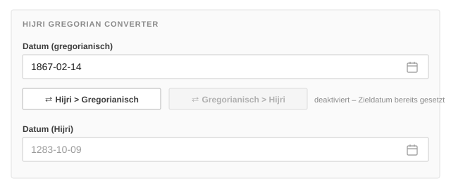

# fylr-plugin-hijri-gregorian-converter

Converts between an Islamic (Hijri) and a Gregorian date directly in the fylr
editor.

It is meant for records that carry **both** calendars: historical holdings
whose sources are dated in Hijri while cataloguing and research happen in
Gregorian, or the other way round. Instead of converting by hand and pasting
the result, the editor gets two buttons that fill one date field from the
other.

This is the fylr port of
[easydb-hijri-gregorian-converter-plugin](https://github.com/programmfabrik/easydb-hijri-gregorian-converter-plugin).
The mask splitter class is deliberately unchanged, so **masks built with the
easydb plugin keep working** after the plugin is replaced — see
[Migrating from the easydb plugin](#migrating-from-the-easydb-plugin).

## What it looks like

The plugin is a *custom mask splitter*. You wrap it around two date fields in
the mask editor, and the editor then renders those two fields with a pair of
conversion buttons between them:



Each button is disabled while its **source** field is empty or holds an
invalid date, and both are disabled once a conversion has been applied, so it
is always clear which direction is available.

## Setup

1. Install the plugin from the fylr marketplace (Administration → Plugin
   Manager) and enable it.
2. In the objecttype's mask, add **two date fields**:
   - the **first** is the Gregorian date,
   - the **second** is the Hijri date.

   Order matters — the plugin reads the first date field it finds as the
   Gregorian one.
3. Select both fields and add the mask splitter **Hijri Gregorian Converter**
   around them.
4. Save the mask. The buttons appear in the editor, not in the detail or
   expert view.

Both fields must be of the **same kind**: two single date fields, or two date
ranges. A single date paired with a range is ignored and the fields render
without buttons.

## Accuracy

Conversion uses the **arithmetic** (tabular) Islamic calendar. Dates
determined by actual moon sighting can differ from the arithmetic result by
about a day, so for records where the exact day matters, treat the converted
value as a starting point and verify it against the source.

## Migrating from the easydb plugin

The easydb plugin stored its splitter in the mask under a type derived from
the splitter's class name. This port keeps that class
(`HijriGregorianConverterMaskSplitter`), so the stored type is unchanged and
existing masks resolve to this plugin without being edited.

What does change is the plugin name itself, from
`easydb-hijri-gregorian-converter` to
`fylr-plugin-hijri-gregorian-converter`. fylr's disk-to-url plugin migration
handles that rename automatically when a pre-6.34 instance is upgraded; a
manual install just needs the old plugin removed and this one installed.

## Development

Built with
[fylr-build-plugin](https://github.com/programmfabrik/fylr-build-plugin):

```sh
make build   # assemble build/fylr-plugin-hijri-gregorian-converter/
make zip     # build the release zip
make check   # validate the build tree against the manifest
```

To run it against a local fylr, point `plugin.paths` at the build folder:

```yaml
plugin:
    paths+:
        - ../fylr-plugin-hijri-gregorian-converter/build
```

A release is cut by publishing a GitHub release with a `vX.Y.Z` tag; the
workflow builds the zip and attaches it, and fylr installs it from
`releases/latest/download/fylr-plugin-hijri-gregorian-converter.zip`.

## License

MIT — see [LICENSE](LICENSE).
